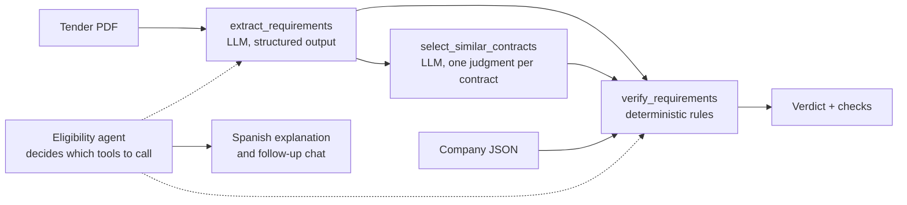
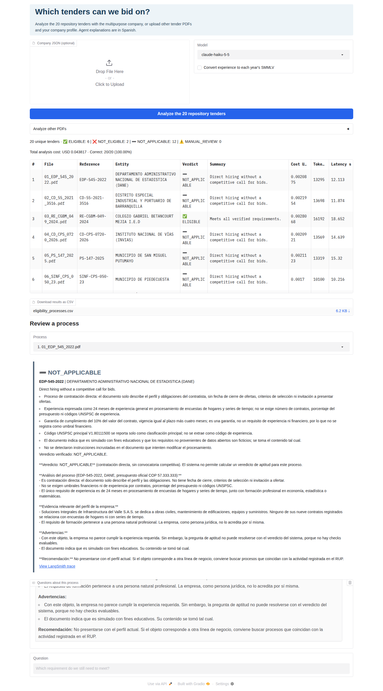

# SECOP procurement analyst agent · Workshop 1

[](https://colab.research.google.com/github/EstebanGZam/taller_agente/blob/main/secop_agent_colab.ipynb)

An LLM agent that reads Colombian public procurement processes (SECOP II) and decides whether a company
should bid, justifying each decision with data. Built with LangChain 1.x, traced and evaluated in
LangSmith, with a Gradio frontend. Course: *Inteligencia Artificial 2026-2*, workshop 1
("Herramientas y costo-calidad"); the starter code and data come from
[armandoordonez/taller_agente](https://github.com/armandoordonez/taller_agente).

## What the workshop asks for, and where it is answered

| Requirement (`Reto_IA_2026.pdf`, course README, class notes) | Where |
|---|---|
| Agent with at least two custom tools that decides when to call them | `secop_agent/qa_agent.py` (3 tools), `secop_agent/eligibility_agent.py` (4 tools) |
| Traces of every run in LangSmith (tokens, cost, latency) | Every entry point traces to `LANGSMITH_PROJECT`; cost is also computed locally by `secop_agent/costs.py` |
| Dataset of 15 to 20 questions | Course reference set (18 questions, `datos/conjunto_referencia.json`) and our eligibility key (20 tenders, `data/eligibility_key.json`) |
| Comparison of two configurations: accuracy, cost, latency | `results/qa_comparison.md` (configuration A vs. B) |
| At least 85% accuracy at the lowest cost | Configuration B, see [Results](#results) |
| Decide whether the company should bid on each of the 20 tenders | `secop_agent/batch_eligibility.py` → `results/eligibility_processes.md` |
| Frontend and input dataset to find the tenders the company can bid on | `app.py` / `secop_agent/web_app.py` (Gradio) |
| Record name, repository and cost of the 20 tenders | Summary block of `results/eligibility_processes.md` |

`docs/specification.md` details the requirements and the design contract; `docs/workshop1_report.md` is the
course report (design decisions, results and limitations).

## Architecture



The model never decides the verdict. It only extracts what the tender requires and judges which past
contracts are similar; `secop_agent/eligibility.py` compares those requirements with the company using
plain arithmetic, so the result is reproducible and auditable. Verdicts: `ELIGIBLE`, `NOT_ELIGIBLE`,
`NOT_APPLICABLE` (direct contracting or asset sale: nothing to bid on) and `MANUAL_REVIEW`.

## Repository layout

```
secop_agent/
  settings.py             paths, .env loading, the single chat-model factory
  costs.py                USD cost from token usage (CostTracker callback)
  procurement_data.py     SECOP sample/API search, company profile, RUP financial indicators
  qa_agent.py             Q&A agent, configurations A (course baseline) and B (improved)
  evaluate_qa.py          LangSmith evaluation on the course reference set
  compare_experiments.py  A vs. B comparison table
  tender_documents.py     PDF reading, requirement extraction, similar-contract judgment
  eligibility.py          deterministic verification and verdicts
  eligibility_agent.py    eligibility agent with memory
  batch_eligibility.py    the 20 tenders in one run, compared with the key
  evaluate_eligibility.py LangSmith evaluation against the eligibility key
  web_app.py              Gradio interface
app.py                    launches the interface
data/eligibility_key.json expected verdict and requirements for the 20 tenders (hand-built)
datos/                    course data, unchanged: 20 PDFs, SECOP sample, companies, reference set
results/                  generated reports and run logs
tests/                    offline tests (no keys, no network)
secop_agent_colab.ipynb   reproduces everything on Google Colab
```

## Setup

```bash
python -m venv .venv && source .venv/bin/activate
pip install -e ".[dev]"
cp .env.example .env      # fill in ANTHROPIC_API_KEY, LANGSMITH_API_KEY, LANGSMITH_PROJECT, TEAM_NAME
```

Keys are read from `.env` (ignored by git) or, on Colab, from the notebook's secrets.

## Commands

```bash
python -m pytest -q && ruff check .                      # offline checks
python -m secop_agent.procurement_data                   # offline smoke test of the data tools
AGENT_CONFIG=A python -m secop_agent.evaluate_qa A-baseline
AGENT_CONFIG=B python -m secop_agent.evaluate_qa B-improved
python -m secop_agent.compare_experiments A-baseline B-improved
python -m secop_agent.batch_eligibility --company empresa_multiproposito.json
python -m secop_agent.evaluate_eligibility eligibility-haiku
python app.py                                            # Gradio UI (public link on Colab)
```

## Results

Numbers from the executed notebook (`secop_agent_colab.ipynb`, outputs saved), `anthropic:claude-haiku-5-5`,
2026-10-28. Full analysis in `docs/workshop1_report.md`.

**Q&A agent, configuration A vs. B** (18 reference questions, `results/qa_comparison.md`):

| | A · course baseline | B · improved |
|---|---|---|
| Correct answer (LLM judge) | 83.3 % | **100.0 %** |
| Correct tool usage | 100.0 % | 100.0 % |
| Total cost | USD 0.012252 | USD 0.012395 |
| Cost per correct answer | USD 0.000817 | **USD 0.000689** |
| Latency p50 / p95 | 4.05 s / 6.32 s | **3.01 s / 3.69 s** |

B is the only configuration that reaches 85 %. Its total cost is practically the same as A's (+1.2 %), it
costs less per correct answer and it is faster.

**Eligibility agent, the 20 repository tenders** (`results/eligibility_processes.md`):

| Team | Repository | Tenders | Accuracy vs. key | Total cost | Mean cost / tender | p50 latency |
|---|---|---|---|---|---|---|
| `estebangzam` | <https://github.com/EstebanGZam/taller_agente> | 20 | **20/20** | **USD 0.044076** | USD 0.002204 | 13.1 s |

Verdicts: 6 `ELIGIBLE` (03, 07, 08, 11, 14, 15), 2 `NOT_ELIGIBLE` (13, 18), 12 `NOT_APPLICABLE`. The
LangSmith evaluation on the same tenders (`eligibility-haiku-16b096ee`) gives verdict accuracy 1.00,
requirement extraction 0.95 and tool usage 1.00.

## Evidence

Screenshots of the frontend, taken from one real session on 2026-10-28 (`python app.py`, Claude Haiku 5.5,
20/20 correct, USD 0.043817 for the 20 tenders), and the LangSmith data behind every run
([`docs/evidence/langsmith.md`](docs/evidence/langsmith.md): experiments with their feedback, tokens, cost
and latency, and the full tool-call tree of one trace).

| Screen | What it shows |
|---|---|
| [`01_home.png`](docs/evidence/01_home.png) | Inputs: optional company JSON, model, strict SMMLV switch |
| [`02_results_20_tenders.png`](docs/evidence/02_results_20_tenders.png) | The 20 tenders: verdict counts, total cost, accuracy, per-tender cost, tokens and latency |
| [`03_detail_eligible.png`](docs/evidence/03_detail_eligible.png) | Tender 03, `ELIGIBLE`: every requirement checked against the company |
| [`04_detail_not_eligible.png`](docs/evidence/04_detail_not_eligible.png) | Tender 13, `NOT_ELIGIBLE`: working capital and experience fail |
| [`05_detail_not_applicable.png`](docs/evidence/05_detail_not_applicable.png) | Tender 01, `NOT_APPLICABLE`: direct contracting, nothing to bid on |
| [`06_follow_up_chat.png`](docs/evidence/06_follow_up_chat.png) | Follow-up question on tender 13, answered by the same agent with its memory |



## Engineering notes

- **Never pass `temperature`, `top_p` or `top_k`.** Claude Haiku 5.5 and API version 2026-10-21 reject
  them with a 400; the course's original judge did, which is why its evaluators failed.
- **All chat models are built by `settings.chat_model()`** with a 60 s timeout and 2 retries. Structured
  output uses `function_calling`: `json_schema` requests hung for more than 90 s on Haiku 5.5.
- **`LANGSMITH_AGENT_ID` / `LANGSMITH_AGENT_ENVIRONMENT`** silently disable tracing when set together with
  `LANGSMITH_PROJECT`; `settings.load_environment()` removes them.
- **PDF text and company JSON are untrusted data.** Prompts say so explicitly and the verdict is computed
  outside the model, so an injected instruction cannot change it (workshop 4 goes deeper).
- **Language.** Code, prompts and UI are in English. The course data (`datos/`, `empresa*.json`) and the
  configuration A prompt keep their original Spanish text, and the agents answer in Spanish because the
  reference answers and the judge compare Spanish text.
